<div align="center">

<a href="https://dtxdex1020.github.io"></a>

<a href="https://dtxdex1020.github.io"></a>

<a href="https://dtxdex1020.github.io">
  
</a>

<p>
  <a href="https://dtxdex1020.github.io"></a>
  <a href="https://minthost.org"></a>
  <a href="https://mintbreeze.org"></a>
</p>

</div>

Founder of MintHost and MintBreeze. I build AI-powered tools for small businesses, and I run Discord &amp; ER:LC bots. Missed calls, slow replies and websites that don't convert cost owners real customers, so I write the software that fixes it and run it end to end: product, code, database, infra, and the support inbox. The bots are their own thing: [Zeltra](https://github.com/dtxdex1020/Zeltra) is a multipurpose Discord + ER:LC bot I run and customize, built on the open-source Ducky V1.

```ts
// about.ts
const dex = {
  role: "founder",
  ships: [
    "MintHost",
    "MintBreeze",
    "Zeltra",
  ],
  languages: [
    "TypeScript",
    "JavaScript",
    "SQL",
  ],
  stack: [
    "Next.js",
    "React",
    "Node.js",
    "Prisma",
    "PostgreSQL",
  ],
  bots: "Zeltra on open-source Ducky V1; discord.js templates",
  rules: [
    "boring tech where it counts",
    "ship small, then listen",
    "privacy is a feature",
  ],
  inbox: "support.minthost@gmail.com",
} as const;
```

### ❯ what I run

**`01` · [MintHost](https://minthost.org)** · lead generation and booking<br>
A chat widget that scores every conversation and nudges hot leads toward a calendar slot. MintHost also builds and hosts the site it lives on.<br>
<sub>`Next.js` `TypeScript` `Prisma` `PostgreSQL` · lead scoring · booking · site hosting</sub>

<a href="https://minthost.org"></a>

**`02` · [MintBreeze](https://mintbreeze.org)** · receptionist and assistant<br>
Answers calls, replies to email, follows up with people who went quiet, books appointments, and sends the owner a morning report.<br>
<sub>`TypeScript` · call handling · email replies · scheduling · daily digest</sub>

<a href="https://mintbreeze.org"></a>

**`03` · [Zeltra](https://github.com/dtxdex1020/Zeltra)** · Discord + ER:LC bot, built on the open-source Ducky V1<br>
A multipurpose Discord + ER:LC bot I run and customize, built on the open-source [Ducky V1](https://github.com/duckyerlc/Ducky-opensource) by duckyerlc. 73 slash commands: moderation with case history, tickets, Roblox verification, staff shifts and LOAs, ER:LC server tools, giveaways and an economy.<br>
<sub>`Lua` `Luvit` `Discordia` · fork of Ducky V1 · AGPL-3.0</sub>

<a href="https://github.com/dtxdex1020/Zeltra"></a>

<sub>MintHost and MintBreeze source is private, and Zeltra is open source. The portfolio site is open: <a href="https://github.com/dtxdex1020/dtxdex1020.github.io">dtxdex1020.github.io</a>, hand-written HTML, CSS and vanilla JS, no framework, no build step.</sub>

### ❯ open source

Small tools I've put out in the open. MIT licensed, tested, take what helps.

**[discord-bot-starter](https://github.com/dtxdex1020/discord-bot-starter)** · Discord bot template<br>
Clean discord.js v14 slash-command starter: auto-loaded commands and events, zod-checked config, cooldowns, error replies.<br>
<sub>`TypeScript` `discord.js` `zod` · template repo</sub>

**[shrt](https://github.com/dtxdex1020/shrt)** · URL shortener<br>
Tiny self-hosted shortener with custom slugs, click counts, rate limiting and a minimal UI, in one container.<br>
<sub>`TypeScript` `Hono` `SQLite` `Docker`</sub>

**[lead-score](https://github.com/dtxdex1020/lead-score)** · lead scoring library<br>
Tags inbound messages hot, warm or cold from budget, timeline, urgency and contact signals.<br>
<sub>`TypeScript` · zero deps · ESM + CJS</sub>

**[slotfinder](https://github.com/dtxdex1020/slotfinder)** · booking slot calculator · [live demo ↗](https://dtxdex1020.github.io/slotfinder/)<br>
Open slots from business hours, time zones, buffers, bookings and blackout dates. DST-safe.<br>
<sub>`TypeScript` `Intl` · zero deps</sub>

**[hookbin](https://github.com/dtxdex1020/hookbin)** · webhook inspector CLI<br>
Catch webhooks locally, pretty-print them, save them to JSON and replay them at your handler.<br>
<sub>`TypeScript` `Node http` `commander`</sub>

**[upcheck](https://github.com/dtxdex1020/upcheck)** · uptime check CLI + GitHub Action<br>
Status, response time, TLS expiry and keyword checks for a list of URLs, with CI-friendly exit codes.<br>
<sub>`TypeScript` · CLI · GitHub Action</sub>

### ❯ stack

<p>
  
  
  
  
  
  
  
  
  
  
  
  
</p>

### ❯ currently shipping



<sub>An illustrative build log for the three projects. Both animations are hand-written SVG and CSS, no scripts.</sub>

### ❯ contact

```sh
$ mail support.minthost@gmail.com
$ open https://minthost.org
$ open https://mintbreeze.org
```

<a href="mailto:support.minthost@gmail.com"></a>
<a href="https://github.com/dtxdex1020"></a>
